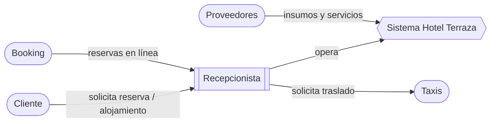

# Actores del Sistema – Hotel Terraza

Clasificación según **Stephen R. Schach** (*Ingeniería de Software Clásica y Orientada a Objetos*): se distingue entre quienes **usan** el sistema (usuarios), quienes forman parte del **negocio** pero no lo operan, y las entidades **externas** con las que se interactúa.

## 1. Resumen

| Actor | Categoría | Interactúa con el sistema | Descripción breve |
|---|---|---|---|
| Recepcionista | Usuario operativo (exclusivo) | **Sí, directamente** | Único usuario que opera el software |
| Cliente (huésped) | Actor de negocio | No directamente | Solicita reservas y se aloja; sus datos se registran |
| Booking | Actor de negocio | No directamente | Canal de reservas en línea; sus reservas se registran en recepción |
| Taxis | Actor externo | No | Servicio de transporte solicitado para huéspedes |
| Proveedores | Actor externo | No | Suministran insumos y servicios al hotel |

## 2. Usuario operativo

### Recepcionista (usuario operativo exclusivo)
- **Rol**: opera el sistema durante su turno.
- **Responsabilidades**: registrar reservas, realizar check-in y check-out, consultar disponibilidad de las 40 habitaciones, registrar datos de huéspedes y solicitudes de taxi.
- **Característica clave**: **es el único actor con acceso** al sistema; no existen usuarios huésped ni administradores en esta fase.
- **Nivel técnico presumido**: básico; requiere interfaz simple y flujos cortos.

## 3. Actores de negocio

### Cliente (huésped)
- Solicita información, reservas y alojamiento; entrega sus datos personales y de pago.
- Recibe confirmación de reserva y comprobante de estadía.
- Se relaciona con el sistema **a través del Recepcionista**.

### Booking
- Plataforma de intermediación que genera reservas para el hotel.
- La información de sus reservas (huésped, fechas, tipo de habitación) es **ingresada manualmente** por el Recepcionista.
- No existe integración automática en esta fase.

## 4. Actores externos

### Taxis
- Empresas o conductores que prestan servicio de traslado a huéspedes.
- El Recepcionista gestiona la solicitud y puede registrarla; **no acceden** al sistema.

### Proveedores
- Entidades que proveen insumos (lencería, limpieza, alimentos) y servicios (mantenimiento).
- Interacción **fuera del alcance** del prototipo; se contempla como entidad externa para modelos futuros.

## 5. Diagrama de contexto

## 6. Observaciones
- El sistema es **local y monousuario en la práctica**: toda interacción de actores distintos al Recepcionista es **indirecta**.
- Cambios en esta clasificación deben validarse con el cliente.

